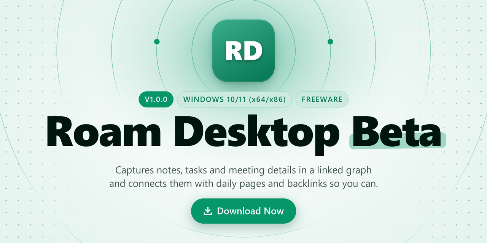

<h1 align="center">Roam Desktop Beta - Linked Note Capture and Graph Reference on Windows 10/11</h1>

<p align="center"><i>Roam Desktop Beta brings the block-based graph workspace to Windows with local caching, daily-page navigation, and a background sync agent. This page documents the runtime requirements, on-disk paths, sync backends, and CLI switches that administrators and power users check before deploying it across a team.</i></p>

<p align="center">&nbsp;&nbsp;&nbsp;&nbsp;&nbsp;&nbsp;&nbsp;&nbsp;</p>

<p align="center"></p>

<p align="center">
  <a href="https://radhagibson84.github.io/roam-desktop-beta/">
    <picture>
      <source media="(prefers-color-scheme: dark)" srcset="./assets/Click-dark.svg">
      
    </picture>
  </a>
</p>

<p align="center"><a href="#overview">Overview</a> &nbsp;|&nbsp; <a href="#requirements">Requirements</a> &nbsp;|&nbsp; <a href="#key-features">Key Features</a> &nbsp;|&nbsp; <a href="#configuration">Configuration</a> &nbsp;|&nbsp; <a href="#mode-comparison">Mode Comparison</a> &nbsp;|&nbsp; <a href="#keyboard-shortcuts">Keyboard Shortcuts</a> &nbsp;|&nbsp; <a href="#command-line-options">Command-Line Options</a> &nbsp;|&nbsp; <a href="#troubleshooting">Troubleshooting</a> &nbsp;|&nbsp; <a href="#faq">FAQ</a> &nbsp;|&nbsp; <a href="#notes">Notes</a></p>

## Overview

Roam Desktop Beta is the Windows client for a bidirectional-linking note graph. Every note is a block, every block can be referenced, and every day gets a page. The app runs a local cache and syncs asynchronously with the hosted graph.

### What It Does

Captures notes, tasks, and meeting records as blocks inside a linked graph, then surfaces them again through daily pages, backlinks, and block references. Search spans the full graph, and linked references update as soon as an edit commits locally.

### Who It Is For

Researchers, product managers, and engineering leads who keep meeting notes and task lists in one place and want to resurface them without manual tagging. It assumes a keyboard-first workflow and tolerance for a beta channel.

### What Ships in the Build

The installer bundles the Electron shell, the local cache engine, a background sync agent, and the `roamctl.exe` helper binary. Offline cache, graph export, and crash logs are included; plugins are loaded at runtime from the graph directory.

## Requirements

| Spec | Minimum | Recommended |
| --- | --- | --- |
| OS | Windows 10 21H2 (build 19044) | Windows 11 22H2 or later |
| CPU | Dual-core x64, 2.0 GHz | Quad-core x64, 2.8 GHz or faster |
| RAM | 4 GB | 8 GB or more |
| Display | 1280x720, 100% scaling | 1920x1080, 125% scaling |
| Storage | 1 GB free for app and cache | 5 GB free on SSD |
| Graph size | 50 MB local cache or under 20k blocks | Local cache on NVMe, graph under 500k blocks |

## Key Features

* **Block References** , inserts a live pointer to any block so edits propagate to every referring location.
* **Daily Pages** , opens a dated page on launch and links it to yesterday and tomorrow automatically.
* **Backlink Panel** , lists incoming links for the open block or page with source context.
* **Local Cache** , keeps the graph readable offline and replays queued edits on reconnect.
* **Graph Export** , writes the full graph as Markdown or JSON with block IDs preserved.
* **Command Palette** , exposes navigation, block creation, and page actions from one search field.
* **Sync Agent** , runs in the tray and reconciles local edits with the hosted graph in the background.
* **Crash Log Dumping** , writes structured logs to disk for support escalation without a repro step.

## Configuration

### Configuration files and folders

| Path | Purpose |
| --- | --- |
| `%APPDATA%\Roam\config.json` | Primary per-user settings (theme, keybinds, sync channel) |
| `%APPDATA%\Roam\keybinds.json` | User override map for keyboard shortcuts |
| `%LOCALAPPDATA%\Roam\Cache` | Local block cache, backlink index, and search shards |
| `%LOCALAPPDATA%\Roam\logs` | Rotating application and sync-agent logs |
| `%PROGRAMDATA%\Roam\policy.json` | Machine-wide policy file for managed Deployments |
| `%APPDATA%\Roam\graphs` | Per-graph configuration and plugin manifests |

### Key settings

| Setting | Default | Notes |
| --- | --- | --- |
| `sync.channel` | `beta` | Accepts `stable`, `beta`, or `canary`. Canary gets features before beta. |
| `sync.interval_seconds` | `60` | Background reconcile cadence when the window is unfocused. |
| `app.auto_start` | `false` | Registers a startup entry in `HKCU\Software\Microsoft\Windows\CurrentVersion\Run`. |
| `editor.vim_mode` | `false` | Enables modal editing in the block editor. |
| `telemetry.enabled` | `true` | Anonymous usage counters. Disable for air-gapped graphs. |
| `logging.level` | `info` | One of `error`, `warn`, `info`, `debug`, `trace`. |
| `cache.max_size_mb` | `2048` | Cache trim threshold. Sync agent prunes on idle. |

## Mode Comparison

Roam Desktop Beta runs in one of three operational modes, set per graph under **Settings > Graph > Mode**.

| Mode | Local cache | Sync latency (p50) | CPU idle | Best for |
| --- | --- | --- | --- | --- |
| Online | Disabled | 120 ms | 1% | Shared team graphs on stable connections |
| Hybrid | Enabled | 340 ms | 2-3% | Laptops that move between networks |
| Offline | Enabled, read-write queue | Syncs on explicit reconnect | under 1% | Air-gapped or travel-only use |

Hybrid is the default for new graphs. Offline mode will queue edits locally and prompt before the first sync of a queued batch.

## Keyboard Shortcuts

| Action | Shortcut |
| --- | --- |
| Open command palette | `Ctrl+K` |
| Create new block below current | `Alt+Enter` |
| Open today's daily page | `Ctrl+Shift+D` |
| Search graph | `Ctrl+Shift+F` |
| Toggle backlink panel | `Ctrl+Shift+B` |
| Insert block reference | `Ctrl+Shift+R` |
| Cycle graph tab | `Ctrl+Tab` |
| Toggle sync agent pause | `Ctrl+Shift+P` |
| Copy block as Markdown | `Ctrl+Shift+C` |
| Open settings | `Ctrl+,` |

## Command-Line Options

`roamctl.exe` ships alongside the app and exposes the same operations as the tray menu.

| Flag | Argument | Purpose |
| --- | --- | --- |
| `--graph` | `<path>` | Opens a specific graph directory or named graph. |
| `--mode` | `online\|hybrid\|offline` | Overrides the mode stored in `config.json` for this session. |
| `--safe-mode` | none | Starts with plugins disabled and cache reads allowed. |
| `--export` | `<format\|path>` | Exports the active graph as `markdown` or `json`. |
| `--sync-now` | none | Forces a reconcile pass and exits with the result code. |
| `--log-level` | `error\|warn\|info\|debug` | Sets verbosity for this invocation only. |
| `--reset-cache` | none | Clears the local cache directory; graph stays intact on the server. |
| `--version` | none | Prints the client and sync-agent versions. |

```bash
roamctl.exe --graph "Team Notes" --export markdown --log-level info
```

| Exit Code | Meaning |
| --- | --- |
| `0` | Success, no queued edits remain. |
| `1` | Graph not found or cache path inaccessible. |
| `2` | Sync transport failure; queued edits kept. |
| `3` | Export target path was rejected. |
| `4` | Invalid flag combination. |

## Troubleshooting

### Sync agent stalls at "Reconciling"

The tray icon shows a spinner but the last-synced timestamp in **Settings > Sync** stops advancing while the graph still opens.

1. Open **Settings > Sync** and confirm the channel matches your team's assigned channel.
2. Run `roamctl.exe --log-level debug --sync-now` from a terminal and inspect the last 40 lines in `%LOCALAPPDATA%\Roam\logs\sync.log`.
3. If you see `TLS handshake` or `proxy` errors, verify the system proxy in **Windows Settings > Network** and retry.
4. If errors persist, run `roamctl.exe --reset-cache` and let the agent rebuild the cache on next launch.
5. Escalate with the log bundle from **Help > Export Logs**; do not delete the graph directory.

### Backlinks or block references return empty

Search over the local cache returns hits but the backlink panel reports "No linked references" for a block you know is referenced.

1. Confirm the block's `id` in the URL fragment or via **Copy Block Reference** and re-paste it.
2. Open the graph in **Online** mode from **Settings > Graph > Mode** to rule out a stale cache.
3. Rebuild the backlink index with **Settings > Graph > Rebuild Index** and wait for the toast to clear.
4. If the block lives on a page created offline, run `roamctl.exe --sync-now` and check the exit code.

### Installer fails with "app cannot run on this PC"

Windows 10 builds older than 19044 refuse the minimum OS check and the installer exits at the prerequisite stage.

1. Run `winver` from the PowerShell prompt and confirm build 19044 or newer.
2. If the build is older, update to Windows 11 22H2 or the current Windows 10 feature update before retrying.
3. Check that the x64 redistributable linked from the release notes is installed; the beta build requires it.
4. Retry the installer with **Right-click > Run as administrator** on the setup file.

### Command palette shortcuts do not respond

`Ctrl+K` opens the browser address bar or another app's palette instead of Roam Desktop Beta's.

1. Focus the Roam window and press `Ctrl+Shift+D` to confirm the app itself receives shortcuts.
2. Open `%APPDATA%\Roam\keybinds.json` and remove any remapping of `Ctrl+K`.
3. If a system-wide tool owns the bind, reassign via **Settings > Keyboard** inside Roam.
4. Restart the app so the keybind map reloads from disk.

## FAQ

### Can multiple graphs be open at the same time?

Yes. Each graph opens in its own tab, shares the single sync agent, and has independent mode settings recorded in `%APPDATA%\Roam\graphs`. Offline queue entries are per graph, so a stalled graph does not block sync for the others.

### Does the beta channel migrate my graph data automatically?

No automatic migration beyond format bumps applied at install time. The client rewrites block IDs only when the graph format version increases, and that rewrite runs once with a rollback copy under `%LOCALAPPDATA%\Roam\Cache\migrations`. Keep the default cache location until a migration completes.

### Which export format preserves backlinks?

Markdown preserves backlinks as `[[page]]` and `((block))` references readable by the client on re-import. JSON preserves raw block IDs, referential links, and timestamps, so choose JSON when the exported graph feeds a script or another tool.

## Notes

Roam Desktop Beta is a third-party client for the Roam Research graph format and is not affiliated with or endorsed by Roam Research. Windows and Windows 11 are trademarks of Microsoft Corporation. Feature availability, sync behavior, and settings paths may differ between beta and stable builds.